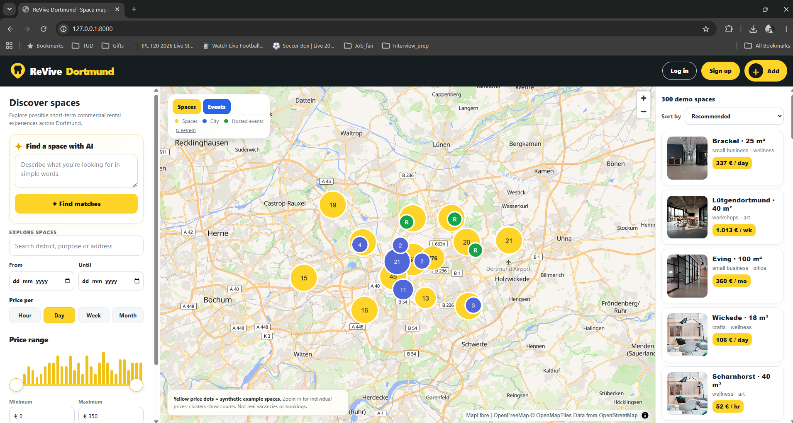
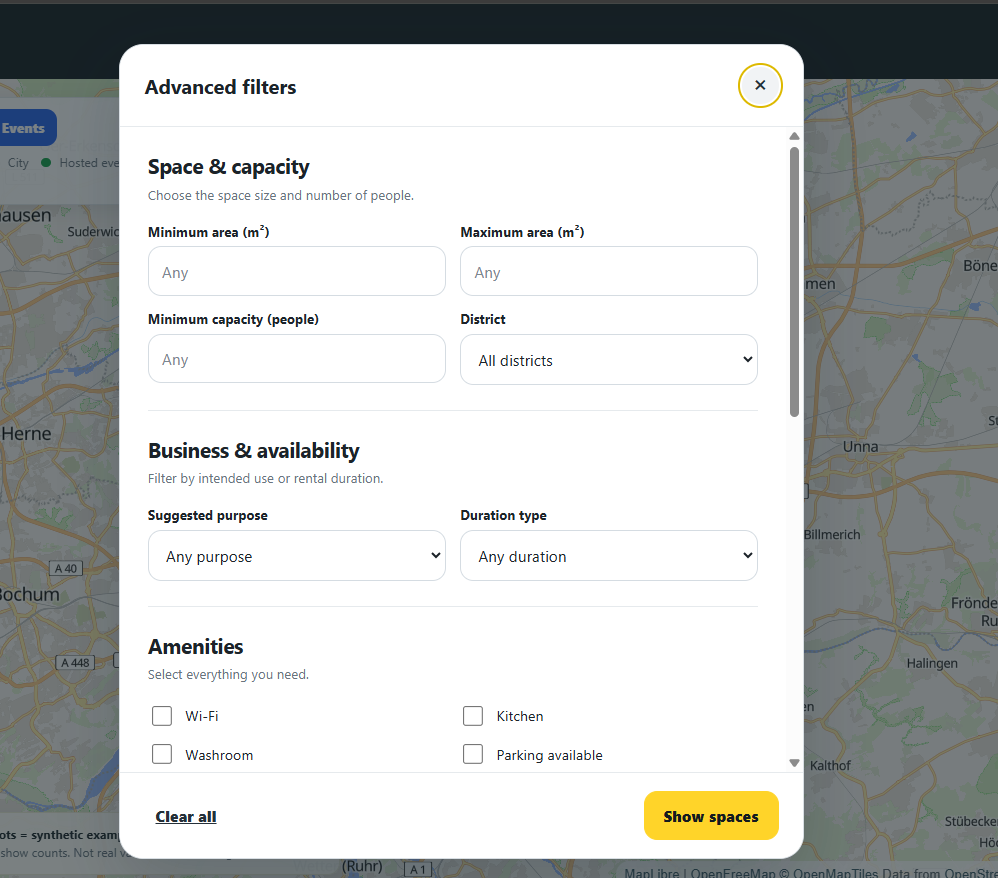
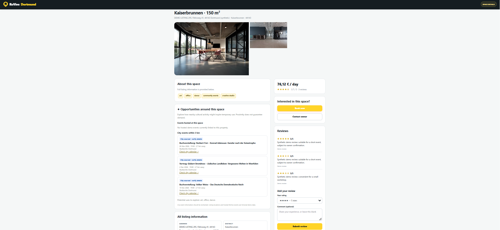
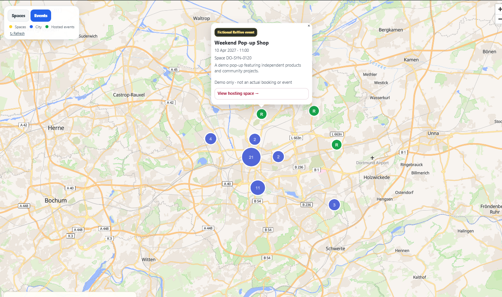
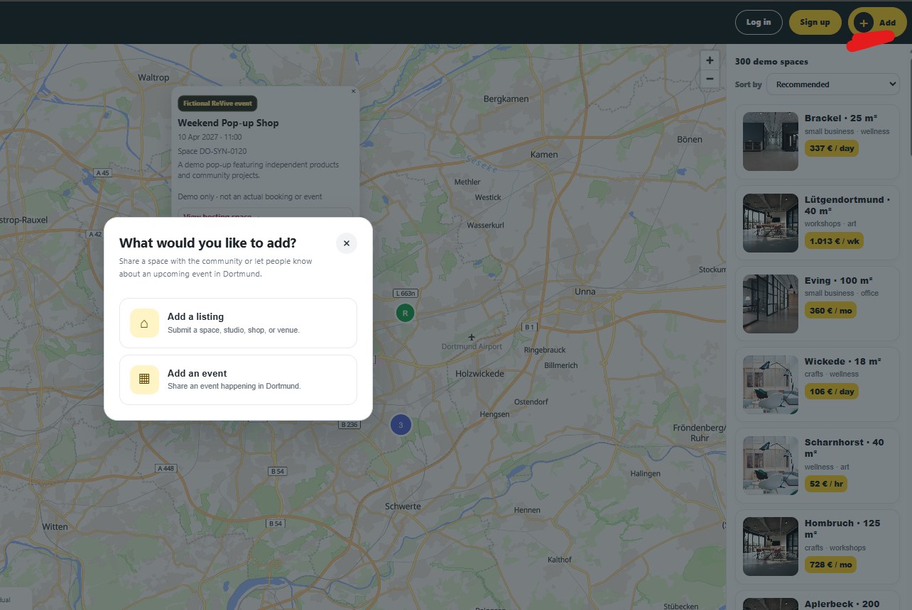
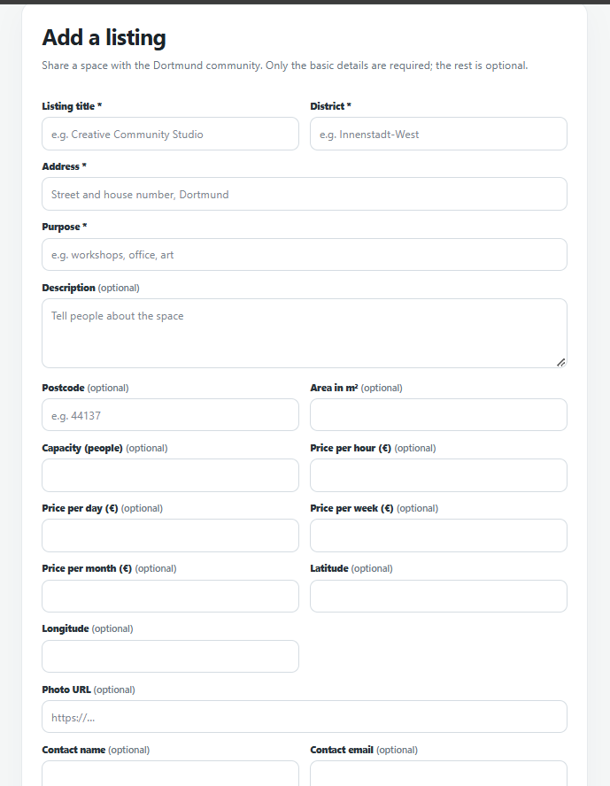

# ReVive: Rethinking Vacant Spaces

> **Revive spaces. Reconnect communities. Rethink urban living.**

ReVive is an "Airbnb for workspaces", and can be used for discovering and reusing underutilised spaces across Dortmund. It combines map-based space discovery, public-event discovery, AI-assisted search, listing details, reviews, and community submissions. Anyone can find and rent workspaces by the hour, day, week or year!

## Contents
- [Problem statement](#problem-statement)
- [Motivation](#motivation)
- [Solution](#solution)
- [Benefits & impact](#benefits-and-impact)
- [Prototype features](#prototype-features)
- [Website walkthrough](#website-walkthrough)
- [Data and sources](#data-and-sources)
- [APIs](#apis)
- [Target audience and business model](#target-audience-and-business-model)
- [Future work](#future-work)
- [Vision](#vision)
- [Links](#links)
- [Team](#team)

## Problem statement
Dortmund has many vacant shops, offices and rooms, but they stay empty because:

- **Empty spaces stay invisible.** There is no easy, current overview of what is free.
- **Demand and supply stay disconnected.** People who need a space cannot find owners, and owners cannot find people.
- **Platforms focus on long-term rentals.** Typical portals (ImmoScout24, WG-Gesucht and similar) are built for long leases or housing.
- **Short rentals are hard.** Many places are available, but it is not easy to rent one for just a few days.

The result: idle buildings, dark shop windows, and good ideas (a pop-up shop, a tutoring class, a workshop) that never start because a long lease is too big a risk.

## Motivation
The idea came from a real search. While looking for a venue for the next DO-DATA hackathon, we saw many empty buildings, but none could be rented for just a few days. Vacant property is more than an empty building: it is a missed economic opportunity and a space that could contribute to the city's development.

## Solution
ReVive is a single platform that brings spaces, people and events together:

- **Flexible duration:** rent a space for anything from 2 days to 2 years.
- **Shared slots:** one space can serve several tenants, e.g. person A Monday to Friday and person B on the weekend.
- **AI search:** describe what you need in plain words, for example *"A tutoring space for my students, under €200 a day"*. A language model turns the sentence into filters, and a rule-based engine searches the listings, so results always come from real records and never from model guesses.
- **Comprehensive listing details:** price, size, capacity, availability, amenities, parking, public transport, nearby places and reviews.
- **Events layer:** public events are shown on the map so you can rent a space near what is happening. Hosts can list their own events.
- **One app for all:** owners, tenants and event organisers use the same platform.

Our goal is to connect **available places with people who can bring them to life**.

## Benefits and impact

**For property owners**
- Income from days and hours that would otherwise stay empty, without signing a long contract.
- Listing is free.

**For tenants (startups, freelancers, small businesses, tutors, clubs)**
- Test an idea for a weekend before committing to a lease.
- Find a matching space in seconds instead of searching through scattered sources.

**For event organisers and communities**
- Find affordable venues close to other local activity.

**For the city**
- Fewer dark windows: short bookings put people back into empty shops.
- Sustainability by design: it unlocks value from buildings that already exist instead of new construction.
- A boost for the local economy and for connected neighbourhoods.
- With real listings, a live picture of which streets have empty space and which kinds of space people want (useful input for the Wirtschaftsförderung).

## Prototype features
- **Interactive map:** Browse spaces geographically.
- **Listing cards:** Scan location, size, purpose, and indicative pricing.
- **Search and filters:** Narrow results to fit user needs.
- **Sorting:** Sort by price, area, availability period, and minimum rental duration when data is available.
- **AI-assisted search:** Find relevant spaces using natural-language descriptions alongside conventional filters.
- **Space details:** View address, size, capacity, pricing, availability, facilities, permitted/suggested uses, photos where available, and reviews.
- **Reviews and ratings:** View feedback and submit a review where enabled.
- **Public events:** Discover event information and locations.
- **Add a listing / Add an event:** The **+ Add** action opens a form for submitting a space or event, with essential fields required and other fields optional.
- **FastAPI backend:** Provides data and supported search, review, and submission operations.

## Website walkthrough

### 1. Map and discovery page

The map is the main entry point. Users browse space markers and cards, search, filter, sort, and explore opportunities around Dortmund.

### 2. Search, filters, and sorting

Users refine results and sort by price, area, availability period, and minimum rental duration. Availability-based sorting relies on relevant data being present.

### 3. Space detail page

A listing page shows practical information such as address, area, capacity, pricing, available days, transport, nearby places, permitted purposes, facilities, photos, and reviews where available. 

### 4. Public events

The event experience shows public events and location information, connecting local activities with places in the city.

### 5. Add a listing or event

The **+ Add** control lets users choose between adding a space and adding an event. Each option opens a form with essential fields required and additional fields optional.

### 6. Submission flow

Forms submit data to the backend. New records are marked pending review in the prototype; a production service should provide full moderation and verification.

## Data and sources
The prototype uses a **mix of synthetic/demo data and real public-event information**.

## APIs
The backend uses **FastAPI**. When running locally, interactive API documentation is available at `/docs`.

| Endpoint | Purpose |
|---|---|
| `GET /` | Serves the web application entry point. |
| `POST /spaces` | Creates a space listing from submitted form data. |
| `POST /events` | Creates a public event from submitted form data. |
| Review endpoints | Support reviews and ratings; consult `/docs` for exact paths and schemas. |
| Search endpoints | Support space discovery and AI-assisted search; consult `/docs` for exact paths and parameters. |

## Target audience and business model
**Target audiences:** property owners and managers; startups and small businesses; event organisers, artists, and creators; NGOs and community groups; residents and visitors.

**Potential future business model** (not currently implemented):
1. Free basic listings and discovery.
2. Commission on confirmed bookings once a real booking workflow exists.
3. Optional premium listing visibility.

## Future work
1. **Verified listings:** Owner verification, moderation, reporting, and expiry of outdated records.
2. **Expanding to different cities:** Expanding our product to cities more cities in Germany.
3. **Accounts and dashboards:** Saved listings, owner tools, and submission management.
4. **Automatic Contract Generation:** Generating contracts between landlors and tenants automatically on the website right after the space is booked.
5. **Impact measurement:** Evaluate utilisation, successful matches, community participation, and sustainability indicators.
6. **Production readiness:** Automated tests, logging, rate limiting, security reviews, and deployment monitoring.

## Vision
**A Dortmund where no space goes to waste, and every empty space holds the potential to bring a community to life.**

We aim to move beyond listing vacant properties: the longer-term vision is a local ecosystem where underused spaces become easier to discover, use, and connect with meaningful activity.

> **Let’s stop seeing empty spaces—and start seeing endless possibilities. Let’s ReVive Dortmund!**

## Links
- **Repository:** [GitHub repository URL](https://github.com/IVAVI17/Rethinking_Vacancies_DO-DATA)
- **Pitch deck:** [Pitch deck URL.](https://drive.google.com/file/d/18TQSlHhD5rSS7CZTb6ZzRctqmKFvex6f/view?usp=sharing)
## Team

| Name | Role | LinkedIn Profile |
|---|---|---|
| Avi Gupta | CEO | [LinkedIn](https://www.linkedin.com/in/avi-gupta17/) |
| Farah Somrani | COO | [LinkedIn](https://www.linkedin.com/in/farah-somrani-981a5526b) |
| Nixon M Paulson | CFO | [LinkedIn](https://www.linkedin.com/in/nixon-m-paulson-b4b309252/) |
| Türkan Yildizoglu | CTO | [Github](https://github.com/turkan367) |